<div align="center">

# Canopy · v2.1

### A little clarity. A lot of possibility.

**A free, database-backed Persian Django dashboard & custom admin by Wiseland Studio.**

Forest `#0A1F17` · Gold `#C9A45A` · RTL · Light & dark · No frontend build step

[Quick start](#quick-start) · [Features](#features) · [Screenshots](#screenshots) · [راهنمای فارسی](docs/README.fa.md)


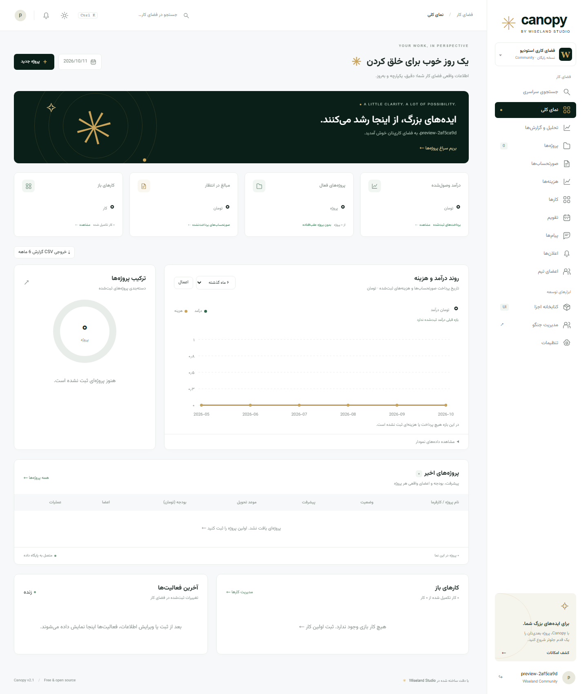

</div>

Canopy is a reusable workspace application for developers, designers, and studios. It combines a branded dashboard with Django administration. All business statistics, charts, categories, team members, deadlines, notifications, and conversations are derived from persisted records. Empty databases show zero totals and useful empty states, never invented business figures.

## Features

| Area | Working functionality |
| --- | --- |
| Projects | Create, edit, confirm/delete, assign real team members, progress, budget, description, detail page, kanban board with drag/drop and accessible status forms |
| Invoices | Create, edit, delete, single/bulk payment recording, payment date, due date, linked project, print/PDF through the browser, filtered CSV |
| Expenses | Create, edit, delete, category, amount, date, linked project, report integration |
| Tasks | Create, edit, delete, assignment, priority, deadline, single/bulk complete/reopen and bulk assignment |
| Reports | Database totals, 3/6/12-month income and expense series, net income, actual period comparison, project category distribution, financial CSV export |
| Calendar | Actual month lengths, previous/next navigation, Tehran times, multi-day events, project/task deadlines |
| Messaging | Persisted private conversations between active users, pagination, unread state, polling every 5 seconds |
| Notifications | New messages, assigned tasks, project/event updates, read individually or mark all read |
| Team | Actual active users, role indicators, per-member project/open-task counts, direct messages, admin user/permission links |
| Account | Profile edit, database-backed theme/direction preferences, password change |
| Administration | Branded live summary, searchable/filterable model lists, user/group permissions, recent activity |
| Interface | Responsive RTL layout, local Vazirmatn font, light/dark mode, independent menu/content scrolling, gold scrollbars, SVG icons, component library |
| Collaboration | Member-scoped project notes with notifications, owner/permission-based note deletion |
| Search | Global search across projects, invoices, tasks, expenses, and events |

Record lists include search, filtering, sorting, and pagination. Mutations validate forms, require relevant permissions, and use CSRF-protected POST requests. Dashboard record changes are logged in an activity feed.

### Scrolling and workflow

The browser document stays fixed on dashboard pages. The sidebar and center content have independent scroll containers. In RTL, the far-right scrollbar controls the menu, while the scrollbar beside the menu controls the center content. The top bar remains visible. LTR mirrors the layout. Invoice printing expands the content for print instead of truncating the scroll container.

Switch projects between table and **Kanban** views. Each status column paginates independently and respects the list filters. Authorized users can drag cards or use their status select/button. Status updates check the previous state so a stale browser cannot silently overwrite another user's move.

Task and invoice lists support selecting visible records. Complete/reopen/assign selected tasks or record payments for selected invoices. Bulk changes validate the entire selection before saving, require model permissions, and run in a transaction. Repeating a payment operation does not change an already-paid invoice's date.

Project notes are visible only to the project's members and users with project management permission. Authors can delete their own notes; other deletions require the note deletion permission. Notes and messages are excluded from public search.

## Quick start

Requires **Python 3.12+**. SQLite is bundled with Python; no Node installation is needed.

```bash
python -m venv .venv
```

Activate the environment:

```powershell
# Windows PowerShell
.venv\Scripts\Activate.ps1
```

```bash
# macOS / Linux
source .venv/bin/activate
```

Then install and run:

```bash
python -m pip install -r requirements.txt
python manage.py migrate
python manage.py createsuperuser
python manage.py runserver
```

- Workspace: **http://127.0.0.1:8000/**
- Django admin: **http://127.0.0.1:8000/admin/**
- Login: **http://127.0.0.1:8000/accounts/login/**

Sign in with your newly created superuser, then add your projects, invoices, expenses, tasks, events, and team members. The source archive contains no account database or default credentials.

### Upgrading from v1

Back up your SQLite database, then run `python manage.py migrate`. Existing project/invoice/task records are retained. Existing paid invoices without a payment date are reported using their issue date until you set their actual payment date.

Optional demo records are **never required**. `python manage.py seed_demo` explicitly adds example records. To remove unchanged records from the original seed, run `python manage.py clear_demo`; it preserves accounts, custom records, and demo projects linked to custom content. Back up first if you want to retain those original examples.

## How the numbers work

- **Received income:** sum of invoices whose status is paid.
- **Pending amount:** sum of unpaid invoices.
- **Monthly income:** payment date, falling back to issue date only for older paid records with no payment date.
- **Monthly costs:** actual expense dates and amounts.
- **Net income:** received income minus expenses for the selected reporting window.
- **Growth:** comparison with the previous window of the same length. Shows a dash when previous income was zero.
- **Project distribution:** actual category counts and calculated percentages.
- **Workload:** real projects and incomplete assigned tasks per active member, without duplicate counts from joins.

All amounts are **Toman**. Dates are **Gregorian**; event times use **Asia/Tehran**. Changing RTL/LTR changes layout direction, not the Persian language. A recorded payment updates the application ledger; it does not charge a card or integrate a payment gateway.

## Screenshots

Real Chrome captures of the application. Financial screenshots show the current empty workspace rather than fictional earnings. The screenshot utility uses temporary accounts for private-page checks, then disposable projects and tasks to verify drag-and-drop and bulk submission; it removes these records and their activity afterward.

| Dark workspace | Custom Django admin |
| --- | --- |
| 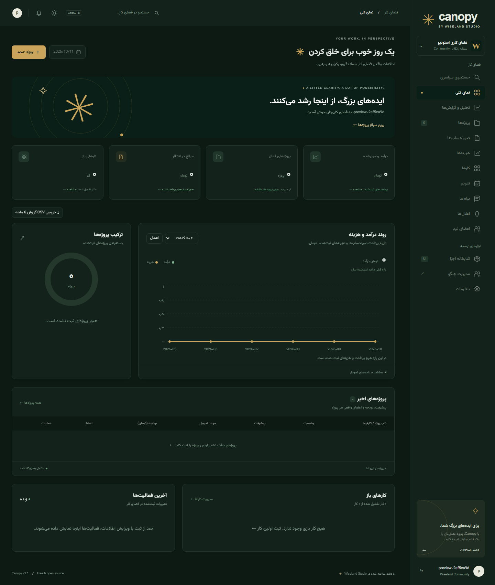 | 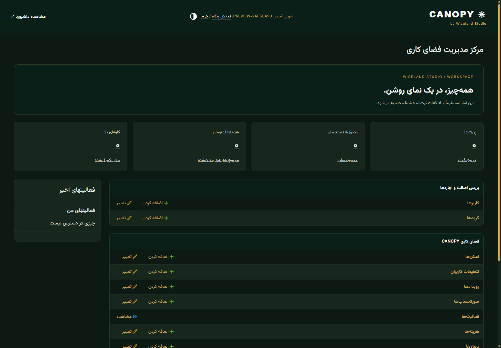 |

| Project management | Calendar |
| --- | --- |
| 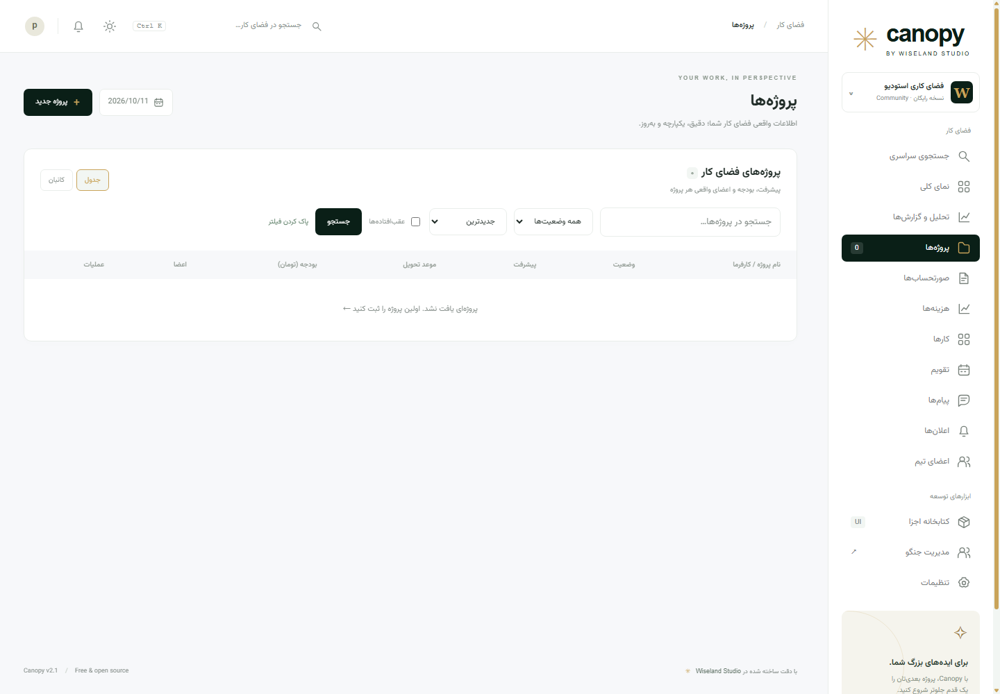 | 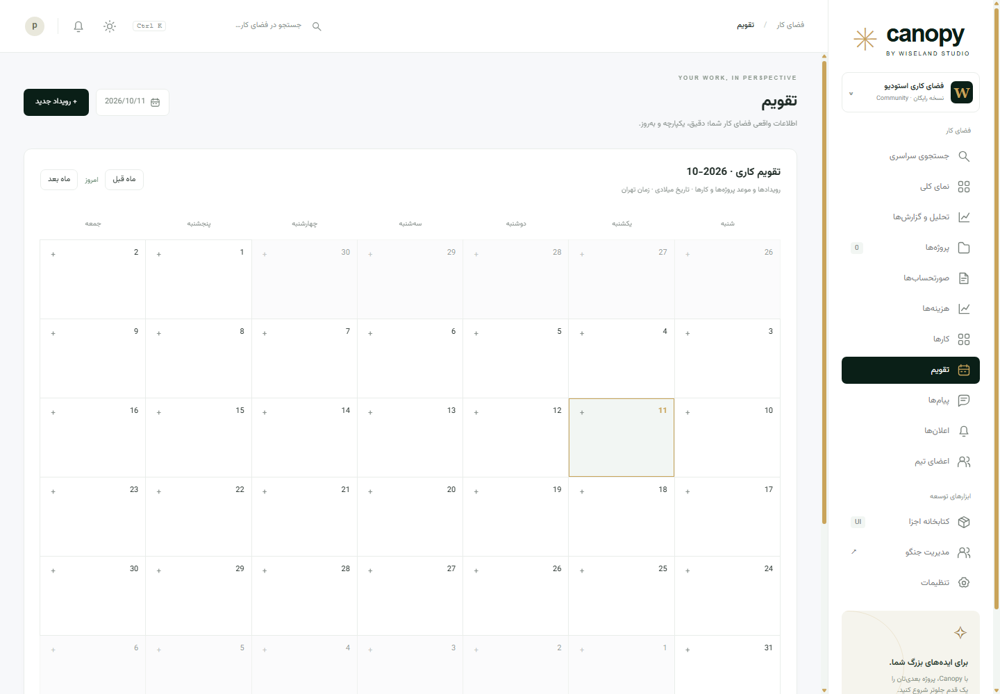 |

| Kanban | Independent scroll regions |
| --- | --- |
| 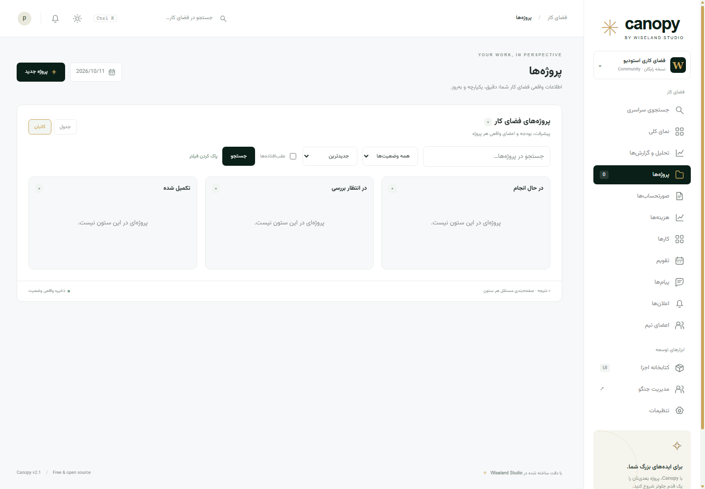 | 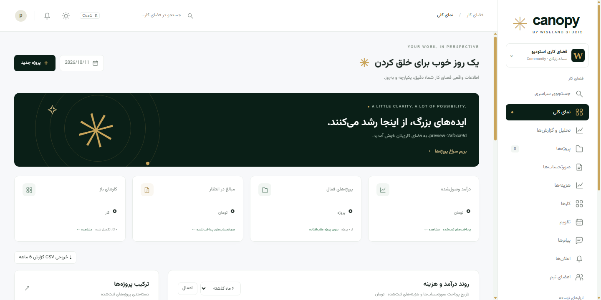 |

| Private conversations | Component library |
| --- | --- |
| 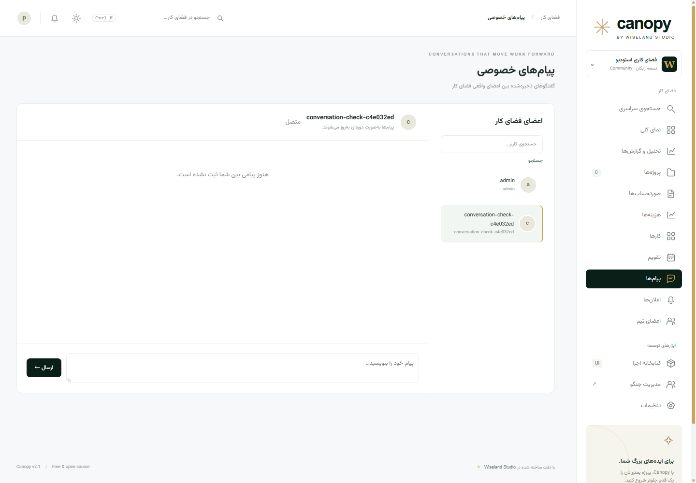 | 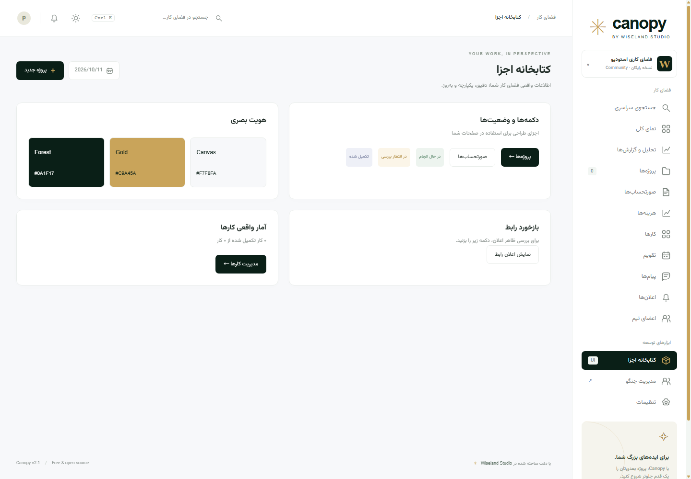 |

| Login | Mobile |
| --- | --- |
| 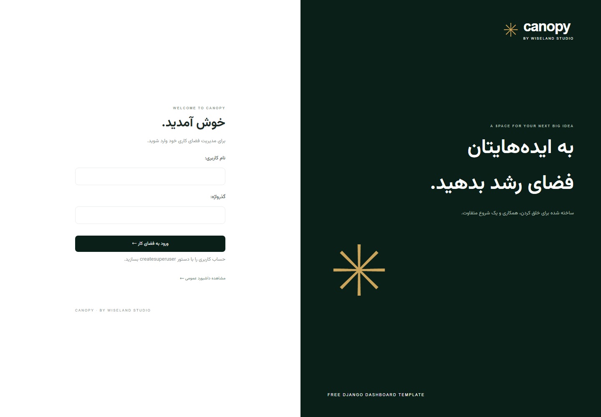 | 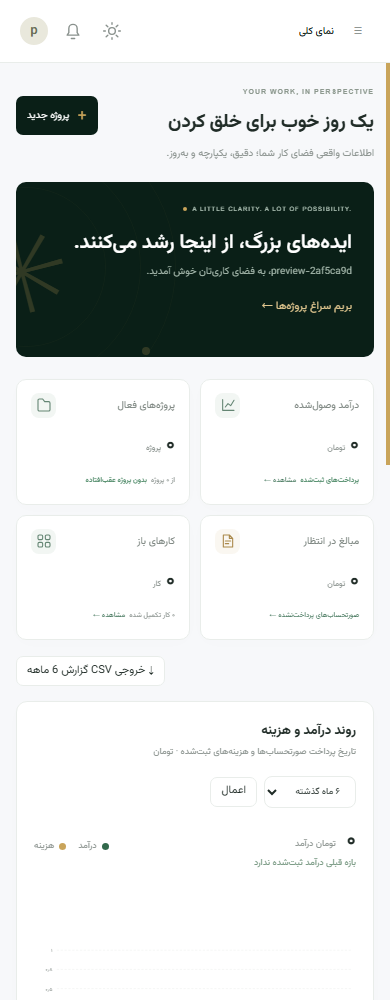 |

## Access and permissions

General workspace reports and record lists are public, matching the public dashboard design. Account settings, conversations, notifications, and the team directory require login. Only conversation participants can read their messages; users can acknowledge only their own notifications and received messages.

Record creation/editing/deletion requires Django model permissions, such as `dashboard.add_project`, `dashboard.change_invoice`, or `dashboard.delete_event`. A superuser has all permissions. Configure other members through Django users/groups. Adding a team member and changing user permissions use Django's administration forms.

The application is a **shared workspace**, not a tenant-isolated SaaS. When using it with private company records, protect public read views and exports with `login_required` and apply your required ownership/organization filters. Private messages are excluded from the admin model registry.

## Routes

| Route | Purpose |
| --- | --- |
| `/`, `/analytics/` | Overview and real financial reports (`?months=3`, `6`, or `12`) |
| `/projects/`, `/projects/<id>/` | Project list and details |
| `/projects/?layout=board` | Kanban with independently paginated columns |
| `/projects/<id>/status/` | Permission-checked status move (POST) |
| `/projects/<id>/comments/` | Private team note creation (POST) |
| `/comments/<id>/delete/` | Note author/permission-checked deletion (POST) |
| `/bulk/task/`, `/bulk/invoice/` | Atomic bulk updates (POST) |
| `/search/?q=...` | Global workspace search |
| `/reports/export/?months=6` | Financial report CSV |
| `/invoices/`, `/invoices/<id>/` | Invoice list and printable detail |
| `/invoices/<id>/pay/` | Record a payment (POST) |
| `/invoices/export/` | CSV export; respects list filters |
| `/expenses/`, `/tasks/` | Expenses and work planning |
| `/tasks/<id>/toggle/` | Complete or reopen a task (POST) |
| `/calendar/?month=YYYY-MM` | Month view, events, deadlines |
| `/records/<kind>/new/` | Create project/invoice/task/expense/event |
| `/records/<kind>/<id>/edit/` | Edit a record |
| `/records/<kind>/<id>/delete/` | Confirm on GET; delete on POST |
| `/messages/?with=<user_id>` | Private conversation |
| `/messages/poll/`, `/messages/read/` | Participant-scoped polling and read acknowledgements |
| `/notifications/` | Your notification history |
| `/team/`, `/settings/` | Team directory and account preferences |
| `/accounts/password/` | Change your password |
| `/components/` | Interface component library |
| `/admin/` | Live admin summary and model management |

## Project structure

```text
canopy/                       Settings, URLs, WSGI
dashboard/
  models.py                   Projects, finance, tasks, events, chat, preferences
  forms.py                    Validated model/account forms
  services.py                 Monthly reports and actual calendar calculations
  views.py                    CRUD, lists, messaging, notifications, account
  context_processors.py       User-specific shell data and unread counts
  admin.py                    Custom AdminSite and model registrations
  migrations/                 Versioned schema
  templatetags/               Currency and user display helpers
  management/commands/        Optional seed/cleanup commands
  test*.py                    Functional and access-control tests
templates/dashboard/
  base.html, workspace.html   Shared shell and section routing
  partials/                   Reusable tables, filters, reports, calendar
templates/admin/              Admin branding and live index
templates/registration/       Login and password change
static/css/, js/, fonts/      Locally bundled interface assets
docs/                         Persian guide and real screenshots
tools/                        Browser checks, screenshots, source ZIP
.github/workflows/            CI checks
```

## Verification

```bash
python manage.py check
python manage.py makemigrations --check --dry-run
python manage.py test
```

Tests exercise zero-data reports, actual income/cost aggregation, category percentages, calendar leap years and multi-day events, record lifecycle, assignment notifications, permissions, message privacy/XSS handling, read cursors, CSV safety, filters/pagination, profile preferences, password changes, and preservation of linked records after project deletion. GitHub Actions runs the Django checks and tests.

The 43-test suite also covers kanban state conflicts and independent column pagination, bulk validation/atomicity/idempotence, private notes and deletion permissions, global search, and financial exports. Browser checks verify clicking the header search button, matching saved records, and focusing search through the clickable shortcut or Ctrl+K with a Persian keyboard layout. On macOS, use Command+K.

For browser checks and refreshing all eleven screenshots, install Chrome and keep the Django server running in another terminal:

```bash
python -m pip install -r requirements-dev.txt
python tools/screenshots.py
```

This verifies rendered chart data against the database, private message persistence, saved account preferences, independent scroll positions/geometry, kanban rendering, mobile layout/menu, and admin overflow. Temporary accounts, messages, sessions, and the headless browser profile are removed afterward. Use a development database. Set `CHROME_PATH` or `SCREENSHOT_URL` if needed; the server must allow the chosen hostname.

## Customization and deployment

Dashboard colors and dimensions are CSS variables in `static/css/canopy.css`. Independent scrolling and workflow styling live in `static/css/workspace.css`; admin styling is in `static/css/admin.css`. SVG icons live in the shared base template. Reporting logic is centralized in `dashboard/services.py`; no remote chart service or hardcoded dataset is used.

Settings read **OS environment variables**; `.env.example` is documentation and is not automatically loaded.

| Variable | Development default |
| --- | --- |
| `DJANGO_DEBUG` | `1` |
| `DJANGO_SECRET_KEY` | Development-only key |
| `DJANGO_ALLOWED_HOSTS` | `localhost,127.0.0.1,testserver` |

For deployment, provide your own secret, disable debug, set hostnames, configure HTTPS/secure cookies and a production WSGI server, protect business data as needed, and serve collected static files:

```bash
python manage.py collectstatic --noinput
python manage.py check --deploy
```

Chat refreshes through authenticated HTTP polling; it does not require a WebSocket server. Data is shared by workspace members according to Django permissions. Payments are ledger records rather than payment processor transactions.

## Downloadable package

```bash
python tools/package.py
```

Creates **`dist/canopy-wiseland-studio-v2.1.0.zip`** with source, assets, migrations, documentation, screenshots, tests, and licenses. Local databases, backups, credentials, `.env`, caches, and virtual environments are excluded. Upload it to your website or a GitHub release.

## License and credits

**MIT License** — free for personal and commercial projects. Preserve the copyright/license notice in distributed copies. See [LICENSE](LICENSE).

Designed and developed by **Wiseland Studio**. [Vazirmatn](https://github.com/rastikerdar/vazirmatn), by Saber Rastikerdar, is bundled under the [SIL Open Font License 1.1](static/fonts/OFL.txt).
